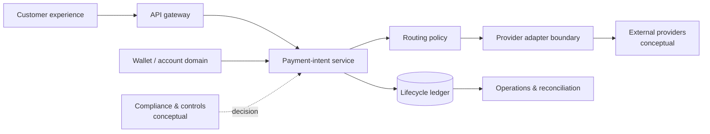

# Architecture notes

## A composable financial-platform pattern

The aim is to let product teams express a **payment intent** once, while an orchestration layer decides whether a represented route can serve that intent. Provider-specific logic stays behind adapters, and lifecycle events form the audit surface.

## Design principles

1. **A rail is a capability, not a UI switch.** Product requests are checked against eligibility, market, currency, provider capability, and operational controls.
2. **Provider adapters are replaceable.** A stable internal request prevents external API details from leaking through the platform.
3. **State is explicit.** Created, routed, submitted, completed, and failed are distinct outcomes; a retry cannot silently duplicate a ledger entry.
4. **Audit is designed in.** Record the routing decision and the resulting lifecycle event without placing sensitive payment data into logs.

## Accuracy and exclusions

The private project has implemented Stripe Treasury connected-account and onboarding work. The wider list of rails above is named in the provider-routing layer as potential integration paths. This public diagram is conceptual and does not claim live enablement, coverage, or regulatory approval for any rail.

It deliberately omits providers, APIs, schemas, credential flows, compliance policy, risk controls, account data, key handling, transaction data, and deployment details.
