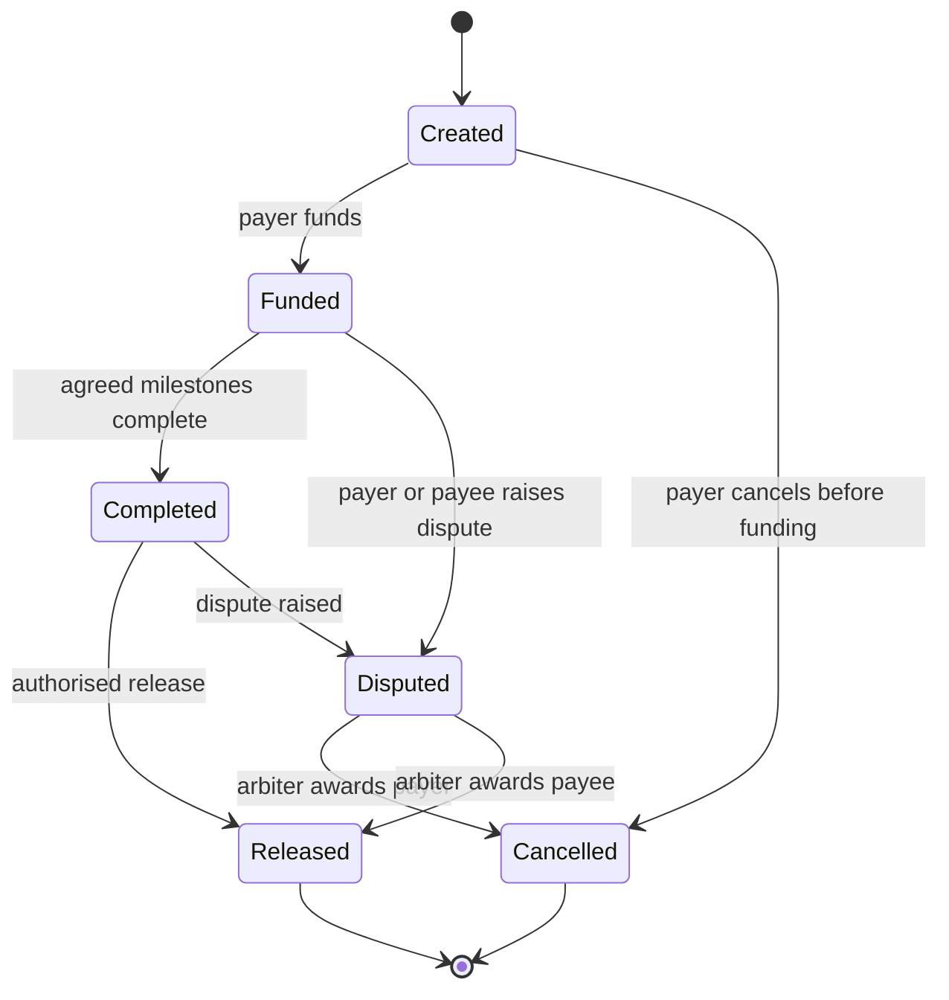
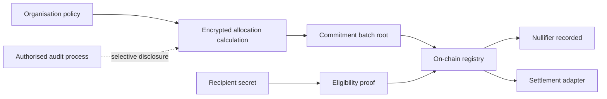

# Contract and confidential-settlement controls — public reference

This reference documents high-level responsibilities represented by the private Hybrid Crypto Bank work. The Solidity samples in this repository are newly authored illustrations, not the private contracts, and must not be treated as production-ready.

## Escrow lifecycle pattern

The represented escrow domain uses explicit states so funds cannot be released twice and disputes become a first-class route rather than an exception.

### Controls represented by this pattern

- **State gating:** an action is accepted only from the relevant prior state; terminal states cannot be reused.
- **Role gating:** payer, payee, and arbiter have intentionally distinct permissions.
- **Replay resistance:** an immutable record identifier plus lifecycle state prevents a second funding, release, or resolution for the same record. For multisignature approvals, a per-transaction, per-owner confirmation record prevents double counting.
- **Reentrancy defence:** value-moving paths should apply checks, update terminal state, and then interact externally under a reentrancy guard. ERC-20 transfers should use established safe-transfer handling.
- **Audit evidence:** creation, funding, milestone, dispute, release, and resolution events provide a traceable lifecycle.

## Confidential allocation reference architecture

For a future privacy-preserving, cross-chain allocation protocol, the public ledger should contain only minimum settlement evidence: a batch commitment (for example, a Merkle root), a policy commitment, nullifiers for consumed entitlements, and settlement events. Individual allocations, recipient identity mappings, and internal policy inputs remain off-chain or encrypted.

### Privacy boundary and residual metadata

A commitment/proof layer can hide individual allocations, recipient mappings, and private policy inputs. It does **not** automatically hide batch timing, public settlement transactions, gas payer, destination contract, source/destination chain, aggregate amounts where they are visible, transaction graph correlations, or a recipient who self-identifies by claiming from a known address. Those leaks must be addressed deliberately through batching, relayers, careful event design, operational timing policy, and clearly scoped audit access.

### Batch entitlement model

1. Compute a leaf commitment from a recipient secret, allocation value, asset, batch identifier, and fresh salt.
2. Publish only the Merkle root and a commitment to the batch policy on-chain.
3. Give each recipient the private witness needed to prove membership and entitlement.
4. Require a unique nullifier derived from the recipient secret and batch identifier when claiming.
5. Verify the proof and mark the nullifier consumed before any settlement action.

The sample [`IllustrativeAllocationRegistry.sol`](../examples/IllustrativeAllocationRegistry.sol) models the public-record portion only. It does not implement a real ZK verifier, FHE computation, cross-chain settlement, token custody, or compliance process.

## ZK and FHE delivery approach

The private projects represented here are not presented as a completed production ZK-plus-FHE protocol. An appropriate first prototype would prove the smallest useful invariant: a recipient may claim once from a committed batch, subject to an allocation and policy constraint, without publishing the allocation. It should establish proof-generation latency, verifier gas cost, trusted-setup assumptions where relevant, nullifier behaviour, and the audit-disclosure model before adding cross-chain settlement or FHE computation.

FHE feasibility should be assessed separately and early: encrypted allocation calculations can carry meaningful performance, key-management, and operational costs. The resulting design should use FHE only where it protects a requirement that commitments and ZK proofs cannot meet on their own.
